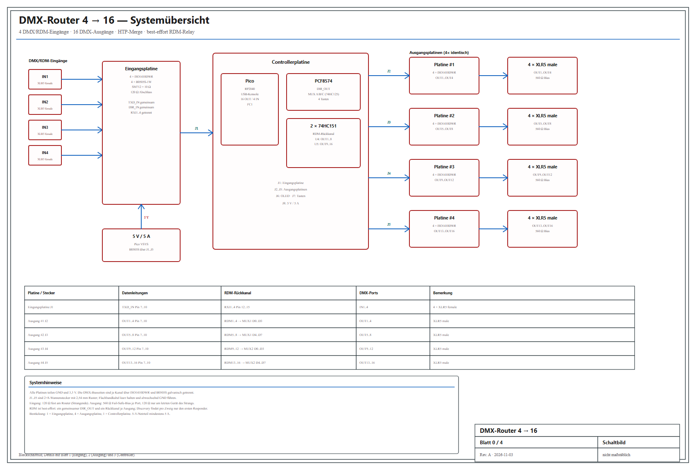
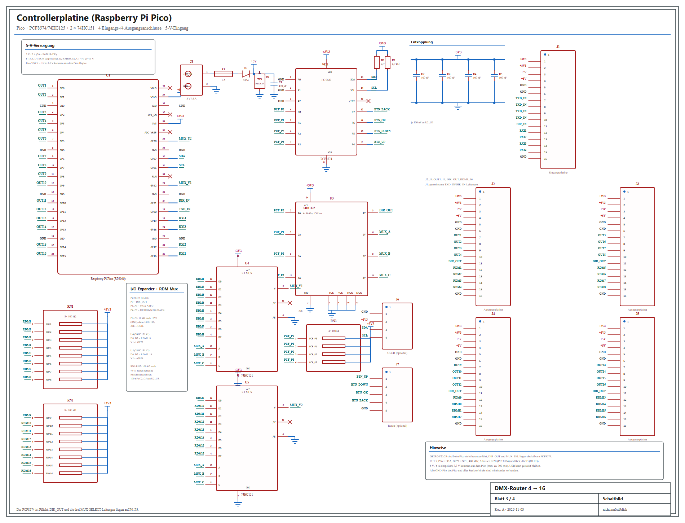
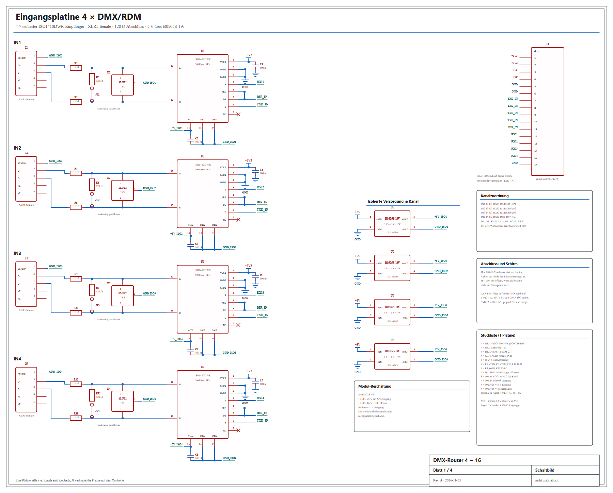
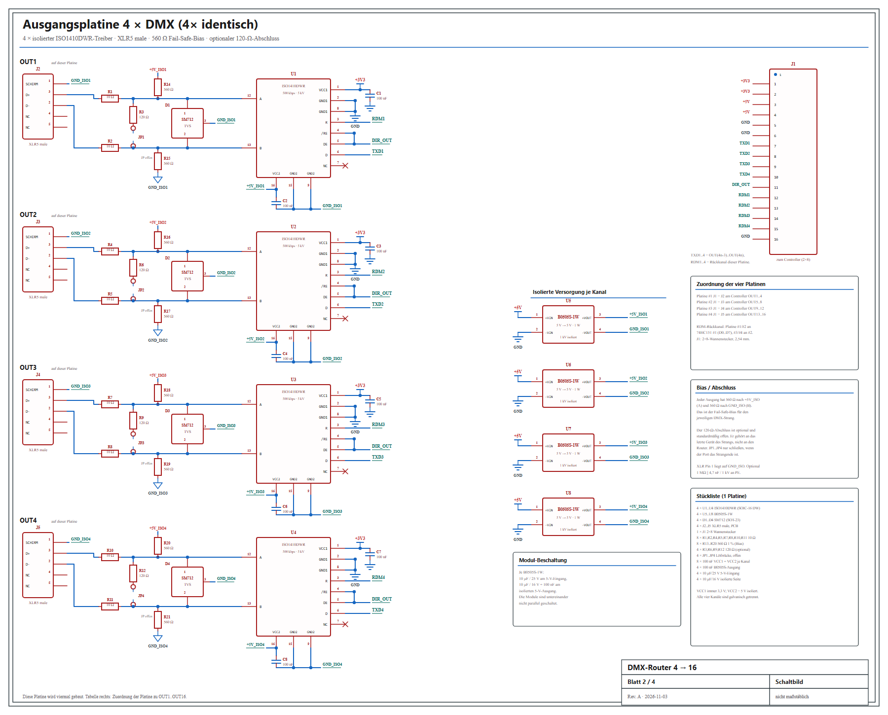

# DMX-Router 4 → 16 — Hardware

Diese Dokumentation beschreibt den kompletten Aufbau des DMX-Routers:
**eine Eingangsplatine**, **vier identische Ausgangsplatinen** und **eine
Controllerplatine**. Die Schaltbilder in diesem Verzeichnis sind
eigenständig und benötigen keine weiteren Unterlagen.

| Datei | Inhalt |
| :--- | :--- |
| `00-system-overview.svg` / `.png` | Blockschaltbild und Zuordnungstabelle |
| `01-input-board.svg` / `.png` | Eingangsplatine, 4 Kanäle |
| `02-output-board.svg` / `.png` | Ausgangsplatine, 4 Kanäle (4× identisch) |
| `03-controller-board.svg` / `.png` | Controllerplatine mit Pico, PCF8574 und Multiplexern |

Die SVGs sind die Quelldateien; die PNGs sind nur zur Ansicht gerendert.

---

## 1. Überblick



| Platine | Anzahl | Aufgabe |
| :--- | ---: | :--- |
| Eingangsplatine | 1 | 4 × isolierter DMX/RDM-Empfänger, XLR5 female, 120 Ω Abschluss |
| Ausgangsplatine | 4 | 4 × isolierter DMX/RDM-Treiber, XLR5 male, 560 Ω Bias |
| Controllerplatine | 1 | Raspberry Pi Pico, PCF8574, 74HC125, 2 × 74HC151, 5-V-Eingang |

Die Ausgangsplatinen sind **elektrisch und im Layout identisch**. Welche
DMX-Ports eine Platine bedient, ergibt sich ausschließlich aus dem
Steckplatz am Controller (J2..J5) und der Firmware-Konfiguration.

### 1.1 Signalfluss

```
IN1..IN4 (XLR5 female)
        │  RXI1..RXI4, gemeinsames TXD_IN / DIR_IN
        ▼
   Eingangsplatine ── 16-pol. Flachbandkabel ──► Controller (J1)
                                                    │
                        Pico: 4 × PIO-UART-Empfänger, HTP-Merge
                                                    │
                        16 × DMX über zwei PIO-Bitplane-Gruppen
                                                    │
              J2..J5 ── 4 × 16-pol. Flachbandkabel ──► 4 × Ausgangsplatine
                                                    │
                        RDM1..RDM16 ◄── 2 × 74HC151 ◄┘
```

Der Controller erzeugt alle 16 DMX-Signale parallel. Jede Ausgangsplatine
erhält vier davon und treibt sie über vier galvanisch getrennte
ISO1410DWR auf XLR5 male. Die RDM-Rückleitungen aller 16 Ausgänge laufen
über zwei 8:1-Multiplexer (74HC151) zurück zum Pico.

---

## 2. Controllerplatine



Der Controller enthält:

* Raspberry Pi Pico (RP2040) als zentrale Recheneinheit
* PCF8574 als I/O-Expander für langsame Steuersignale und Tasten
* 74HC125 als Treiber für `DIR_OUT` und die drei MUX-SELECT-Leitungen
* zwei 74HC151 für den RDM-Rückkanal
* 5-V-Eingang mit Verpolschutz, Sicherung, TVS und Bulk-Kondensator
* Steckverbinder für Eingangsplatine, vier Ausgangsplatinen, OLED und Tasten

### 2.1 Pico-Pinbelegung

Der RP2040 hat 30 GPIOs, ein Standard-Pico führt aber nur **GP0..GP22 und
GP26..GP28** auf den Kopfleisten heraus (26 nutzbare Pins). `GP23` und
`GP25` liegen nur auf Testpads; `GP24` (VBUS-Sense) und `GP29`
(VSYS-Sense) stehen nicht zur Verfügung. Deshalb liegen `DIR_OUT` und die
drei MUX-SELECT-Leitungen auf einem PCF8574.

| Pico-Pin | GPIO | Funktion | Richtung |
| ---: | ---: | :--- | :--- |
| 1, 2, 4..7, 9..12, 14..17, 19, 20 | GP0..GP15 | **OUT1..OUT16** | Ausgang, PIO |
| 21, 22, 24, 25 | GP16..GP19 | **RXI1..RXI4** | Eingang, PIO-UART |
| 26 | GP20 | **TXD_IN** gemeinsam | Ausgang, UART1-TX |
| 27 | GP21 | **DIR_IN** gemeinsam | Ausgang |
| 29 | GP22 | **MUX_Y1** | Eingang, 74HC151 #1 |
| 31 | GP26 | **I2C1 SDA** | bidirektional |
| 32 | GP27 | **I2C1 SCL** | Ausgang |
| 34 | GP28 | **MUX_Y2** | Eingang, 74HC151 #2 |
| 36 | 3V3 | +3,3 V | Versorgung der Logik |
| 39 | VSYS | +5 V | Versorgung des Pico |
| 3, 8, 13, 18, 23, 28, 33, 38 | GND | Masse | — |

Nicht verwendet: Pin 30 (`RUN`), Pin 35 (`ADC_VREF`), Pin 37 (`3V3_EN`),
Pin 40 (`VBUS`). `VBUS` bleibt offen, weil der Pico über `VSYS` versorgt
wird; die USB-Buchse kann trotzdem zum Flashen und für die Konsole
verwendet werden.

### 2.2 PCF8574 und 74HC125

Der PCF8574 hängt an **I2C1** (`GP26` = SDA, `GP27` = SCL) und hat die
Adresse **0x20** (`A0..A2` = GND). Die Firmware spricht den Bus über
`Wire1` an; `Wire` wäre beim Pico I2C0 (GP4/GP5).

| PCF-Pin | Funktion | Beschaltung |
| ---: | :--- | :--- |
| P0 | `DIR_OUT` | über 74HC125, 10 kΩ nach +3V3 |
| P1 | `MUX_SEL A` (LSB) | über 74HC125, 10 kΩ nach +3V3 |
| P2 | `MUX_SEL B` | über 74HC125, 10 kΩ nach +3V3 |
| P3 | `MUX_SEL C` (MSB) | über 74HC125, 10 kΩ nach +3V3 |
| P4 | Taste UP | gegen GND, aktiv-low |
| P5 | Taste DOWN | gegen GND, aktiv-low |
| P6 | Taste OK | gegen GND, aktiv-low |
| P7 | Taste BACK | gegen GND, aktiv-low |

Der **PCF8574 ist Pflicht**. Ohne ihn können `DIR_OUT` und die
MUX-SELECT-Leitungen nicht aktiv gesteuert werden; die Firmware meldet
dann `[err] PCF8574 not found - DIR_OUT/MUX are fixed`. RN3 zieht die
Leitungen auf High, sodass die Ausgänge senden, der RDM-Rückkanal aber
auf Kanal 7 festhängt. Das OLED und die Tasten sind optional, die
Konfiguration bleibt über die USB-Konsole möglich.

Die vier Ausgänge P0..P3 werden durch einen **74HC125** gepuffert. Dessen
vier `/OE`-Eingänge liegen auf GND, die Buffer sind also immer aktiv. Die
10-kΩ-Pull-ups (RN3) stellen sicher, dass die CMOS-Eingänge des 74HC125
auch bei quasibidirektionalem High-Pegel des PCF8574 einen definierten
Pegel sehen.

Der PCF8574 wird im **Read-Modify-Write** betrieben: Beim Schreiben werden
P4..P7 immer auf 1 gehalten, damit die Tasten ihre schwachen Pull-ups
behalten.

### 2.3 RDM-Multiplexer (74HC151)

Beide Multiplexer teilen sich die Select-Leitungen `MUX_A/B/C`
(PCF8574 P1..P3, gepuffert durch den 74HC125). `A` ist das LSB.

| 74HC151 | Eingänge D0..D7 | Ausgang | Pico |
| :--- | :--- | :--- | :--- |
| U4 (#1) | RDM1..RDM8 | Y1 | GP22 |
| U5 (#2) | RDM9..RDM16 | Y2 | GP28 |

`/E` (Enable) liegt auf GND, `/Y` bleibt offen. Die Select-Leitungen
wählen innerhalb einer Achtergruppe den Kanal 0..7. Die Eingänge werden
über RN1/RN2 (8 × 100 kΩ) nach +3V3 hochgezogen, damit nicht gesteckte
oder abgeschaltete Rückleitungen einen definierten DMX-Idle-Pegel haben.

### 2.4 5-V-Eingang

| Bauteil | Funktion |
| :--- | :--- |
| J8 | 2-pol. Schraubklemme, 5 V / 5 A |
| F1 | Feinsicherung 5 A (träge) |
| D1 | SS34, Verpolschutz in Reihe |
| D2 | SMBJ5.0A, Transientenschutz |
| C1 | 470 µF / 10 V, Bulk-Kapazität |

Durch D1 fällt die Versorgung um ca. 0,4 V. Ein 5,0-V-Netzteil liefert
damit ca. 4,6 V am Pico-`VSYS` und an den B0505S-Modulen; das liegt
innerhalb der zulässigen Bereiche (B0505S: 4,5..5,5 V, Pico-SMPS:
1,8..5,5 V). Bei einem Netzteil mit 4,9 V oder weniger ist der Abfall
zu groß — dann ein 5,1-V- oder 5,2-V-Netzteil verwenden.

Die 3,3-V-Schiene wird vom Pico-Regler erzeugt und über die
Flachbandkabel an die Eingangs- und Ausgangsplatinen verteilt. Der
Pico-Regler liefert ca. 300 mA; die tatsächliche Last liegt deutlich
darunter (siehe Abschnitt 7).

### 2.5 Steckverbinder

| Stecker | Typ | Ziel |
| :--- | :--- | :--- |
| J1 | 2×8, 2,54 mm | Eingangsplatine |
| J2 | 2×8, 2,54 mm | Ausgangsplatine #1 (OUT1..4) |
| J3 | 2×8, 2,54 mm | Ausgangsplatine #2 (OUT5..8) |
| J4 | 2×8, 2,54 mm | Ausgangsplatine #3 (OUT9..12) |
| J5 | 2×8, 2,54 mm | Ausgangsplatine #4 (OUT13..16) |
| J6 | 1×4, 2,54 mm | OLED (GND, +3V3, SDA, SCL) |
| J7 | 1×5, 2,54 mm | Tasten (UP, DOWN, OK, BACK, GND) |
| J8 | 2-pol. Schraubklemme | 5 V / 5 A |

### 2.6 Stückliste Controller

| Anzahl | Bezeichnung | Wert / Typ |
| ---: | :--- | :--- |
| 1 | U1 | Raspberry Pi Pico (RP2040) |
| 1 | U2 | PCF8574 (DIP-16 oder SOIC-16) |
| 1 | U3 | 74HC125 |
| 2 | U4, U5 | 74HC151 |
| 1 | RN1 | 8 × 100 kΩ (RDM1..8) |
| 1 | RN2 | 8 × 100 kΩ (RDM9..16) |
| 1 | RN3 | 4 × 10 kΩ (PCF P0..P3) |
| 2 | R1, R2 | 4,7 kΩ (I2C-Pull-ups) |
| 4 | C2..C5 | 100 nF (Entkopplung U2..U5) |
| 1 | C1 | 470 µF / 10 V |
| 1 | F1 | 5 A, träge, mit Halter |
| 1 | D1 | SS34 |
| 1 | D2 | SMBJ5.0A |
| 5 | J1..J5 | 2×8 Wannenstecker, 2,54 mm |
| 1 | J6 | 1×4 Stiftleiste |
| 1 | J7 | 1×5 Stiftleiste |
| 1 | J8 | 2-pol. Schraubklemme, 5,08 mm |
| optional | — | SSD1306 128×64, 4 Taster |

---

## 3. Eingangsplatine



Die Eingangsplatine enthält vier **identische, galvanisch getrennte**
Empfangskanäle. Jeder Kanal besteht aus:

* XLR5 **female** (J2..J5), Pin 1 = Schirm, Pin 2 = D−, Pin 3 = D+,
  Pin 4/5 = NC
* SM712-TVSDiode an A/B
* zwei 10-Ω-Schutzwiderstände in den Datenleitungen
* 120-Ω-Abschlusswiderstand, über eine Lötbrücke **werksseitig
  geschlossen**
* ISO1410DWR (VCC1 = 3,3 V, VCC2 = 5 V isoliert)
* B0505S-1W für die isolierte 5-V-Versorgung

### 3.1 Kanäle

| Kanal | XLR | ISO1410DWR | RXI | 10 Ω | 120 Ω | Brücke | B0505S |
| :--- | :--- | :--- | :--- | :--- | :--- | :--- | :--- |
| IN1 | J2 | U1 | RXI1 | R1/R2 | R3 | JP1 | U5 |
| IN2 | J3 | U2 | RXI2 | R4/R5 | R6 | JP2 | U6 |
| IN3 | J4 | U3 | RXI3 | R7/R8 | R9 | JP3 | U7 |
| IN4 | J5 | U4 | RXI4 | R10/R11 | R12 | JP4 | U8 |

Alle vier ISO1410DWR teilen sich:

* `TXD_IN` (Pico GP20) — alle vier `D`-Pins parallel
* `DIR_IN` (Pico GP21) — alle vier `DE`/`/RE`-Paare parallel

Die Empfangsleitungen `RXI1..RXI4` sind getrennt und gehen auf
GP16..GP19.

### 3.2 Abschluss und Schirm

Der 120-Ω-Abschluss sitzt am Router, weil die Eingangsplatine das
**Ende des Eingangsstrangs** ist. JP1..JP4 nur öffnen, wenn die Platine
nicht am Strangende sitzt (z. B. bei einer Schleifendurchführung).

XLR Pin 1 liegt auf `GND_ISO`. Optional kann je Kanal ein
**1 MΩ || 4,7 nF / 1 kV** von `GND_ISO` an PE gelegt werden, um
HF-Störungen abzuleiten, ohne die galvanische Trennung aufzugeben.

### 3.3 Stückliste Eingangsplatine (1×)

| Anzahl | Bezeichnung | Wert / Typ |
| ---: | :--- | :--- |
| 4 | U1..U4 | ISO1410DWR (SOIC-16 DW) |
| 4 | U5..U8 | B0505S-1W |
| 4 | D1..D4 | SM712 (SOT-23) |
| 4 | J2..J5 | XLR5 female, PCB |
| 1 | J1 | 2×8 Wannenstecker, 2,54 mm |
| 8 | R1, R2, R4, R5, R7, R8, R10, R11 | 10 Ω |
| 4 | R3, R6, R9, R12 | 120 Ω |
| 4 | JP1..JP4 | Lötbrücke, geschlossen |
| 12 | C1..C8 + 4× Modul | 100 nF (8× VCC1/VCC2, 4× Modulausgang) |
| 4 | — | 10 µF / 25 V (5-V-Eingang) |
| 4 | — | 10 µF / 16 V (isolierte Seite) |
| optional | — | 4 × 1 MΩ + 4 × 4,7 nF / 1 kV (Schirm an PE) |

---

## 4. Ausgangsplatine (4× identisch)



Die Ausgangsplatine ist elektrisch wie die Eingangsplatine aufgebaut, aber
mit **XLR5 male**, **560-Ω-Fail-Safe-Bias** und einem **optionalen**
120-Ω-Abschluss (Standard: offen).

### 4.1 Kanäle

| Kanal | XLR | ISO1410DWR | TXD | RDM | 10 Ω | Bias | 120 Ω | Brücke | B0505S |
| :--- | :--- | :--- | :--- | :--- | :--- | :--- | :--- | :--- | :--- |
| 1 | J2 | U1 | TXD1 | RDM1 | R1/R2 | R13/R14 | R3 | JP1 | U5 |
| 2 | J3 | U2 | TXD2 | RDM2 | R4/R5 | R15/R16 | R6 | JP2 | U6 |
| 3 | J4 | U3 | TXD3 | RDM3 | R7/R8 | R17/R18 | R9 | JP3 | U7 |
| 4 | J5 | U4 | TXD4 | RDM4 | R10/R11 | R19/R20 | R12 | JP4 | U8 |

Jeder Kanal hat:

* 560 Ω von A nach `+5V_ISO`
* 560 Ω von B nach `GND_ISO`
* optional 120 Ω zwischen A und B (Lötbrücke offen)

Der Bias hält den Strang bei nicht treibendem Sender auf einem
definierten Idle-Pegel. Der Abschluss gehört an das **letzte Gerät** des
Strangs, nicht an den Router; deshalb ist JP1..JP4 standardmäßig offen.

### 4.2 Zuordnung der vier Platinen

| Platine | Controller-Stecker | DMX-Ports | RDM-Rückkanal |
| :--- | :--- | :--- | :--- |
| #1 | J2 | OUT1..OUT4 | RDM1..4 → MUX #1 D0..D3 |
| #2 | J3 | OUT5..OUT8 | RDM5..8 → MUX #1 D4..D7 |
| #3 | J4 | OUT9..OUT12 | RDM9..12 → MUX #2 D0..D3 |
| #4 | J5 | OUT13..OUT16 | RDM13..16 → MUX #2 D4..D7 |

Auf der Platine selbst heißen die Leitungen immer `TXD1..TXD4` und
`RDM1..RDM4`. Erst der Steckplatz am Controller legt fest, welche
DMX-Ports und welche RDM-Multiplexer-Eingänge daraus werden.

### 4.3 Abschluss und Schirm

* 560-Ω-Bias ist fest bestückt und immer aktiv.
* 120-Ω-Abschluss nur schließen, wenn der Port das Strangende ist.
* XLR Pin 1 liegt auf `GND_ISO`; optional 1 MΩ || 4,7 nF / 1 kV an PE.
* Die vier Kanäle einer Platine haben **getrennte** isolierte Massen
  (`GND_ISO1..4`). Sie werden auf der Platine nicht miteinander
  verbunden.

### 4.4 Stückliste Ausgangsplatine (1×)

| Anzahl | Bezeichnung | Wert / Typ |
| ---: | :--- | :--- |
| 4 | U1..U4 | ISO1410DWR (SOIC-16 DW) |
| 4 | U5..U8 | B0505S-1W |
| 4 | D1..D4 | SM712 (SOT-23) |
| 4 | J2..J5 | XLR5 male, PCB |
| 1 | J1 | 2×8 Wannenstecker, 2,54 mm |
| 8 | R1, R2, R4, R5, R7, R8, R10, R11 | 10 Ω |
| 8 | R13..R20 | 560 Ω, 1 % |
| 4 | R3, R6, R9, R12 | 120 Ω (optional) |
| 4 | JP1..JP4 | Lötbrücke, offen |
| 12 | C1..C8 + 4× Modul | 100 nF (8× VCC1/VCC2, 4× Modulausgang) |
| 4 | — | 10 µF / 25 V (5-V-Eingang) |
| 4 | — | 10 µF / 16 V (isolierte Seite) |
| optional | — | 4 × 1 MΩ + 4 × 4,7 nF / 1 kV (Schirm an PE) |

---

## 5. Steckerbelegung der 2×8-Verbindungen

Alle fünf Platinenanschlüsse (Controller J1..J5, Eingangsplatine J1,
Ausgangsplatinen J1) verwenden dasselbe 16-polige Raster. Die Bedeutung
der Pins 7..15 hängt von der Platine ab.

| Pin | Controller J1 → Eingang | Controller J2..J5 → Ausgang | Eingangsplatine J1 | Ausgangsplatine J1 |
| ---: | :--- | :--- | :--- | :--- |
| 1 | +3V3 | +3V3 | +3V3 | +3V3 |
| 2 | +3V3 | +3V3 | +3V3 | +3V3 |
| 3 | +5V | +5V | +5V | +5V |
| 4 | +5V | +5V | +5V | +5V |
| 5 | GND | GND | GND | GND |
| 6 | GND | GND | GND | GND |
| 7 | TXD_IN | OUT(4n−3) | TXD_IN | TXD1 |
| 8 | TXD_IN | OUT(4n−2) | TXD_IN | TXD2 |
| 9 | TXD_IN | OUT(4n−1) | TXD_IN | TXD3 |
| 10 | TXD_IN | OUT(4n) | TXD_IN | TXD4 |
| 11 | DIR_IN | DIR_OUT | DIR_IN | DIR_OUT |
| 12 | RXI1 | RDM(4n−3) | RXI1 | RDM1 |
| 13 | RXI2 | RDM(4n−2) | RXI2 | RDM2 |
| 14 | RXI3 | RDM(4n−1) | RXI3 | RDM3 |
| 15 | RXI4 | RDM(4n) | RXI4 | RDM4 |
| 16 | GND | GND | GND | GND |

Auf der Eingangsplatine sind die Pins 7..10 **auf der Platine
miteinander verbunden** (gemeinsames `TXD_IN`). Auf der Ausgangsplatine
sind sie getrennt (`TXD1..TXD4`).

**Kabel:** 2×8-Flachbandkabel, Raster 2,54 mm, kodiert. Wegen der
250-kbaud-Signale und der begrenzten Zahl an GND-Adern möglichst kurz
halten (Richtwert < 20 cm). Bei längeren Kabeln zusätzliche GND-Adern
zwischen die Signale legen.

---

## 6. ISO1410DWR-Beschaltung

### 6.1 Pinbelegung

| Pin | Name | Funktion |
| ---: | :--- | :--- |
| 1 | VCC1 | Logikversorgung, **3,3 V** |
| 2 | GND1 | Logikmasse |
| 3 | R | Empfangsdaten zur Logik |
| 4 | /RE | Receiver Enable, low aktiv |
| 5 | DE | Driver Enable, high aktiv |
| 6 | D | Sendedaten von der Logik |
| 7 | NC | nicht angeschlossen |
| 8 | GND1 | Logikmasse |
| 9 | GND2 | isolierte Masse |
| 10 | NC | — |
| 11 | NC | — |
| 12 | A | Bus A (DMX D+) |
| 13 | B | Bus B (DMX D−) |
| 14 | NC | — |
| 15 | GND2 | isolierte Masse |
| 16 | VCC2 | isolierte Versorgung, **5 V** |

### 6.2 Beschaltung

* **VCC1 = 3,3 V**, damit `R`, `D`, `DE` und `/RE` direkt mit dem
  RP2040 verbunden werden können. Bei 5 V an VCC1 würden 5-V-Pegel am
  Pico anliegen; der RP2040 ist nicht 5-V-tolerant.
* **VCC2 = 5 V isoliert** aus dem B0505S-1W. Zwischen VCC2 und GND2
  sitzt ein 100-nF-Kondensator; am Modulausgang zusätzlich 10 µF.
* **`/RE` und `DE` sind zusammengefasst** und gehen auf `DIR`:
  * `DIR` = low → Empfang
  * `DIR` = high → Senden
* **Pin 7 ist NC** und bleibt offen (im Schaltbild mit X markiert). Der
  ISO1410DWR hat keinen `PV`-Pin. Ein Anschluss an VCC1 oder GND wäre
  laut Datenblatt zulässig, ist aber nicht erforderlich.
* **`A`/`B`** gehen über 10 Ω an XLR Pin 3/2. Der SM712 schützt beide
  Leitungen gegen ESD und Surge.
* **XLR Pin 1** liegt auf GND2 (`GND_ISO`), nicht auf der Logikmasse.
* Der ISO1410DWR ist die **500-kbps-Variante** und damit für DMX mit
  250 kbps ausreichend. Er hat einen Failsafe-Empfänger für offenen,
  kurzgeschlossenen und ruhenden Bus sowie eine Last von 1/8 Unit Load
  (bis 256 Knoten). Der 560-Ω-Bias auf der Ausgangsplatine ist deshalb
  nicht zwingend, bleibt aber für Kompatibilität bestückt.

### 6.3 Isolation

Der ISO1410DWR ist nach UL für **5 kV rms** (7071 V<sub>PK</sub>
VIOTM) ausgelegt, das B0505S-1W für 1 kV. Die **Systemisolation wird
damit vom B0505S auf 1 kV begrenzt**. Für DMX ist das mehr als
ausreichend. Logikmasse (`GND`) und isolierte Masse (`GND_ISO`) dürfen
nirgends verbunden werden.

---

## 7. Stromversorgung

### 7.1 5-V-Schiene

| Verbraucher | Strom (Richtwert) |
| :--- | ---: |
| 20 × ISO1410DWR, VCC1 (3,3 V, ca. 3,2 mA) | ca. 65 mA |
| Pico + PCF8574 + 74HC125 + 2 × 74HC151 | ca. 80 mA |
| OLED (optional) | ca. 20 mA |
| **3,3-V-Summe** | **ca. 165 mA (max. ca. 200 mA)** |

Die 3,3-V-Last liegt unter den ca. 300 mA des Pico-Reglers. Sie wird
über die 2×8-Kabel verteilt; pro Platine sind zwei +3V3-Pins
parallelgeschaltet.

| Verbraucher | Strom (Richtwert) |
| :--- | ---: |
| 16 × Ausgangs-B0505S (je ca. 130 mA Eingangsstrom) | ca. 2,1 A |
| 4 × Eingangs-B0505S (je ca. 10 mA Eingangsstrom) | ca. 40 mA |
| 16 × 560-Ω-Bias (isoliert, im obigen Wert enthalten) | — |
| Pico + Logik über VSYS | ca. 100 mA |
| **5-V-Summe typisch** | **ca. 2,2 A** |
| **5-V-Summe Worst-Case** (16 × 160 mA isoliert, ca. 200 mA Eingang) | **ca. 3,3 A** |

Ein **5-V-Netzteil mit 5 A** ist für den Dauerbetrieb und die
Einschaltströme ausgelegt. 3 A wären im typischen Fall knapp, im
Worst-Case aber zu wenig. Die 1-W-B0505S-Module sind mit ca. 130 mA
Eingangsstrom pro Ausgangskanal etwa zur Hälfte belastet; bei 160 mA
isolierter Last (Datenblatt-Maximum des ISO1410DWR) erreichen sie
80 % ihrer Nennlast.

J8, F1 und die 5-V-Leiterbahnen auf der Controllerplatine sind für
**5 A** auszulegen (breite Leiterbahnen, idealerweise 70-µm-Kupfer).
Die 2×8-Verbindungen zu den Ausgangsplatinen führen maximal ca. 0,8 A
pro Platine; dafür genügen die beiden parallelen +5V-Pins.

### 7.2 Einschaltreihenfolge

Die 5-V-Versorgung speist gleichzeitig den Pico und alle B0505S-Module.
Die 3,3-V-Schiene kommt aus dem Pico. Es gibt keine besondere
Einschaltreihenfolge; die ISO1410DWR sind auf beiden Seiten entkoppelt.
Wird nur USB gesteckt, läuft die Logik; über die interne Diode des Pico
werden auch die 5-V-Schiene und die B0505S-Module mitversorgt. Wegen des
USB-Stromlimits ist das nur für Tests geeignet — für den vollen Betrieb
ist die 5-V-Einspeisung über J8 nötig.

---

## 8. Abschluss, Bias und Schirmung

| Platine | 120 Ω | Bias | Bemerkung |
| :--- | :--- | :--- | :--- |
| Eingang | fest, JP geschlossen | keiner | Router ist Strangende |
| Ausgang | optional, JP offen | 560 Ω an A/B | Router ist Stranganfang |

Regeln:

* Ein DMX-Strang wird an **beiden Enden** mit 120 Ω abgeschlossen.
* Bias (Fail-Safe) nur an **einer** Stelle im Strang; hier im Router.
  Der ISO1410DWR bringt bereits einen Failsafe-Empfänger mit, der
  560-Ω-Bias ist daher eine zusätzliche Absicherung und kann entfallen,
  wenn alle Empfänger im Strang failsafe sind.
* Der Schirm (XLR Pin 1) wird auf `GND_ISO` geführt und nicht mit der
  Logikmasse verbunden.
* Optional kann `GND_ISO` über 1 MΩ || 4,7 nF / 1 kV an PE gelegt
  werden. Das leitet HF-Störungen ab, ohne die galvanische Trennung
  aufzuheben.
* Die vier Kanäle einer Platine haben getrennte isolierte Massen. Werden
  mehrere Ausgänge an Geräte mit gemeinsamer Schirmmasse angeschlossen,
  können sich die `GND_ISO`-Inseln über die Kabel verbinden; die
  Isolation zur Logik bleibt erhalten.

---

## 9. Aufbau und Prüfung

1. **Sichtprüfung:** Alle Polaritäten (D1, D2, Elkos, ICs) prüfen;
   Lötbrücken JP1..JP4 auf den gewünschten Zustand bringen.
2. **Isolation:** Auf jeder Platine den Widerstand zwischen `GND` und
   `GND_ISO` messen — muss hochohmig sein (> 1 MΩ). Ebenso zwischen
   `+5V` und `+5V_ISO`.
3. **5-V-Eingang:** Zuerst nur den Controller ohne Ausgangsplatinen
   bestücken, Netzteil strombegrenzt auf 200 mA, Spannung langsam
   hochfahren. Nach D1 ca. 4,6 V messen; 3,3 V am Pico prüfen.
4. **PCF8574:** Nach dem Boot muss die Konsole `[ui] PCF8574 at 0x20`
   melden. Fehlt die Meldung, I2C-Adresse und Pull-ups prüfen.
5. **Ausgänge:** Oszilloskop an OUT1. Break ca. 192 µs, MAB ca. 16 µs,
   danach 513 Byte mit 44 µs/Byte. Bei 40 Hz erscheint alle 25 ms ein
   Frame.
6. **Eingänge:** Pult an IN1; `status` muss `frames` hochzählen und
   `active yes` zeigen.
7. **RDM-Multiplexer:** `rdm status`, dann `rdm test <out> <frame>`.
   Der Rückkanal muss den adressierten Port auswählen; bei nicht
   gesteckter Platine liefert der 100-kΩ-Pull-up einen Idle-Pegel.
8. **Abschluss:** Bei einem einzelnen kurzen Kabel ohne Endgerät muss
   der Bus sauberen Idle-Pegel zeigen; bei fehlendem Abschluss sind
   Reflexionen sichtbar.

---

## 10. Dateien und Generierung

Die Schaltbilder werden aus Python-Quellen erzeugt:

```bash
cd DMX-Router/Hardware
python generate_schematics.py
python check_layout.py 00-system-overview.svg 01-input-board.svg \
                       02-output-board.svg 03-controller-board.svg
```

* `schematic_lib.py` — SVG-Helfer, Rahmen, Symbole
* `sheet_overview.py` — Blockschaltbild
* `sheet_input.py` — Eingangsplatine
* `sheet_output.py` — Ausgangsplatine
* `sheet_controller.py` — Controllerplatine
* `generate_schematics.py` — Einstiegspunkt
* `check_layout.py` — grobe Prüfung auf Textüberläufe und Kollisionen

Voraussetzung ist Python 3.8 oder neuer; es werden keine externen
Bibliotheken benötigt. Die PNGs werden optional mit headless Chrome
gerendert:

```bash
chrome --headless=new --disable-gpu --hide-scrollbars \
       --force-device-scale-factor=1 --window-size=1900,1450 \
       --screenshot=03-controller-board.png \
       file:///.../03-controller-board.svg
```

Die SVG-Dateien sind die maßgebliche Quelle. Nach Änderungen immer
`generate_schematics.py` und `check_layout.py` ausführen.

---

## 11. Gesamtstückliste

| Bauteil | Eingang | Ausgang (4×) | Controller | Gesamt |
| :--- | ---: | ---: | ---: | ---: |
| ISO1410DWR | 4 | 16 | — | 20 |
| B0505S-1W | 4 | 16 | — | 20 |
| SM712 | 4 | 16 | — | 20 |
| XLR5 female | 4 | — | — | 4 |
| XLR5 male | — | 16 | — | 16 |
| PCF8574 | — | — | 1 | 1 |
| 74HC125 | — | — | 1 | 1 |
| 74HC151 | — | — | 2 | 2 |
| Raspberry Pi Pico | — | — | 1 | 1 |
| 2×8 Wannenstecker | 1 | 4 | 5 | 10 |
| 10 Ω | 8 | 32 | — | 40 |
| 120 Ω | 4 | 16 | — | 20 |
| 560 Ω | — | 32 | — | 32 |
| 100 nF | 12 | 48 | 4 | 64 |
| 10 µF / 25 V | 4 | 16 | — | 20 |
| 10 µF / 16 V | 4 | 16 | — | 20 |
| 470 µF / 10 V | — | — | 1 | 1 |
| 4,7 kΩ | — | — | 2 | 2 |
| 100 kΩ-Netzwerk (8×) | — | — | 2 | 2 |
| 10 kΩ-Netzwerk (4×) | — | — | 1 | 1 |
| SS34 | — | — | 1 | 1 |
| SMBJ5.0A | — | — | 1 | 1 |
| Feinsicherung 5 A | — | — | 1 | 1 |

Hinzu kommen Schraubklemme J8, Stiftleisten für OLED/Tasten, optional
SSD1306 und vier Taster.
